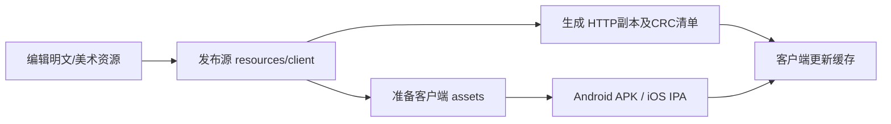

# 02 客户端资源位置、图片修改与发布

[返回扩展指南](扩展指南索引.md)。游戏公共资源已统一到 `resources/client`，与客户端、服务端代码分离。目录迁移对照见 [项目目录说明](../项目目录结构.md)。

## 1. 哪个目录是修改入口

| 目录 | 定位 | 修改建议 |
|---|---|---|
| `archive/client-resources` | 历史明文资料：PNG、TXT、Lua、CCBI等 | 用于查阅和取材；实际修改及发布以 `resources/client` 为准 |
| `resources/client` | 当前实际发布源 | Android准备、iOS准备、HTTP资源生成都从这里取文件 |
| `client/source/Game/proj.android/res_anzhi` | Android渠道原生资源 | 启动界面、Android图标/布局等；与游戏内卡牌PNG不是同一套 |
| `client/source/Game/proj.android/antbuild/anzhi/assets`、`res` | Android生成目录 | 不作长期修改入口，重新准备时可能覆盖 |
| `client/ios/generated/assets` | iOS生成目录 | 修改发布源后重新生成 |
| `runtime/server/web/gameserver/dzm/1.8` | 部署后的HTTP资源副本 | 不作唯一编辑源，重新部署可能覆盖 |
| 安装到手机后的应用专属目录 | 解包资源、更新文件、版本信息 | 旧缓存可能优先于新包；勿把它当源码目录 |

具体复制逻辑：[prepare_android.py](../../deployment/prepare_android.py)、[iOS prepare.py](../../client/ios/prepare.py)、[configure_deployment.py](../../scripts/configure_deployment.py)。`1.8` 是固定URL路径，`1.78.6` 这类字符串是资源版本，不应把二者混成一个值。

## 2. 常用图片在哪

以下均相对于资源根目录：

| 路径/文件 | 主要内容 | 对应表 |
|---|---|---|
| `members/` | 船员头像 | `Disciples.txt` 的 `iconPic` |
| `person/` | 人物立绘、卡面/战斗图 | `Disciples.txt` 的 `bodyPic`、`battlePic` |
| `equipposter/` | 装备海报/图标 | `Equips.txt` |
| `skillposter/` | 奥义图标/海报 | `Skills.txt` |
| `itemposter/` | 道具图标 | `Tools.txt` 等 |
| `mainScene/`、`loadingScene/` | 主界面、加载界面资源 | CCBI和相应页面代码 |
| `battle/`、`effect/`、`s_*.ccbi` 等 | 战斗动作、特效与时间轴 | `Skills.txt` 和 `FightTasksSkill.cpp` |
| `Imagesetfile/` 及其他 `.plist` / 纹理文件 | 合图、精灵帧索引 | CCBI、预加载依赖和帧名 |
| `*.fnt`、对应纹理、`Lang/chinese.lang` | 位图字体与界面文字 | C++ / Lua 的语言键和CCBI |
| `sound/` 和根目录音频 | 角色、技能、背景音 | 人物/技能表及页面配置 |

`chartex/...`、`equiptex/...`、`skilltex/...` 这类表字段可能是合图里的逻辑帧名，不保证对应独立磁盘文件。修改之前先搜索文件名、相关 `.plist` 和加载依赖，不要因为找不到同名PNG就直接删除字段。

## 3. 同名替换一张图片

以索隆头像为例：

```text
archive/client-resources/members/head_char_suolong.png
resources/client/members/head_char_suolong.png
```

1. 保留原图备份，在 `resources/client` 编辑或替换图片；需要原始素材时参考归档目录。
2. 尽量保持文件名、原尺寸、透明背景、视觉中心和留白一致。旧CCBI可能按固定尺寸定位。
3. 确认新图位于发布目录的同一相对路径，不需要维护两份长期编辑源。
4. 若对应的是合图帧，修改合图源并重新导出纹理与 `.plist`；帧尺寸、裁剪、旋转和偏移必须一起更新。只往目录增加一张独立PNG，不会覆盖内存中已注册的同名精灵帧。
5. 更新资源版本并按第6节发布。完全退出客户端再启动，检查头像、卡面、阵容和战斗等使用位置。

普通PNG是标准图片格式，抽样检查发布目录中的索隆头像也是正常PNG头，不需要用AES加密。只改同名独立PNG通常无需修改C++；换文件名或新增卡牌则要同步表里的路径。

## 4. 文本表为什么看起来像乱码

发布目录中的部分TXT使用自定义封装，以十六进制 `EF FE` 开头，后续为异或处理的压缩数据。加载入口在 [GamePlatform.cpp](../../client/source/Game/Platform/GamePlatform.cpp) 的 `getFileData()` / `decBuffer()`；iOS旧平台实现见 [GamePlatform.mm](../../client/source/Game/Platform/GamePlatform.mm)。这与同目录普通PNG、UTF-16文本、AES示例不是同一回事。

此次把 `Disciples.txt`、`Equips.txt`、`Skills.txt`、`Yuanfens.txt`、`TeamBuff.txt` 发布文件按源码规则解码，均与明文资料中的文件逐字节相同。编辑这些表时可以：

1. 在明文目录用文本编辑器修改，保持UTF-8、原表头和字段顺序。
2. 将编辑后的**普通UTF-8表**放到发布目录同名路径。上述 `getFileData()` 对没有 `EF FE` 封装的文件直接返回原始内容，因此这些走该入口的TXT可以用明文发布。
3. 如果继续使用旧封装，应按现有代码的压缩/异或格式生成并确认解码一致，不能只改扩展名或套AES。

明文发布是从读取代码得出的可用编辑路线，本轮未实际打包验证新表。不要把它推广成“所有资源均可任意转明文”。

[TableReader.cpp](../../client/source/Game/Classes/TableReader.cpp) 以及 [DataTableManager.h](../../client/source/Game/Classes/DataTableManager.h) 还决定了表解析规则：

- 第一行表头被跳过；中间空行可能使后续数据不再读取。
- 多数对象用 `std::stringstream >>` 顺序读字段。名称、描述等字段中新增ASCII空格/换行可能造成字段错位；沿用现有格式，不要随意插入空列。
- PowerShell 5 的默认文本写入编码不一定是UTF-8。不要用默认 `Out-File` 把TXT写成UTF-16。
- Protobuf生成Lua表不是策划表，修改协议应修改定义并重新生成两端文件。

## 5. CCBI、Lua和预加载依赖

游戏页面主要由 `*.ccbi` 加C++或Lua控制；技能的 `ccbFile`、`timeLine` 和替换帧也在数据表中。CCBI是二进制布局/动画文件，应通过兼容的CocosBuilder工程或工具修改。仓库中存在导出物不代表完整可编辑设计工程都齐全，修改前应确认原工程和导出版本。

预加载示例为 `mainUI_ccbi.dep`，由 `LoadingGroup` 使用。增加新合图、页面、动作后，要核对对应依赖；文件放进去不等于一定被预加载。

Android旧Lua加载器 [Cocos2dxLuaLoader.cpp](../../client/source/scripting/lua/cocos2dx_support/Cocos2dxLuaLoader.cpp) 最终读取 `.el` 并调用 `decBuffer()`。Windows编译分支会尝试由 `.lua` 生成 `.el`，手机端不能依赖这一步。修改 `.lua` 后要同步可加载的 `.el`，不能只保留同名旧 `.el`。Lua封装与 `EF FE` TXT封装的外层格式也不同。

## 6. 如何让已有安装看到修改



### 推荐路线：更新版本后重新打包

1. 完成发布源修改并提交Git；iOS云构建需要远端仓库已经有新资源。
2. 依 [服务端更新流程](01_服务端数据保存与奖励发放.md#6-修改后如何更新) 保存进度、停服、备份。
3. 用原部署状态中的IP和端口执行 `Deploy-Server.ps1 -Action install`，把 `-ResourceVersion` 从当前值提升，例如 `1.78.6`→`1.78.7`。
4. Android执行 `deployment/build-android.cmd`；iOS Actions的 `resource_version` 填入相同新值。具体安装签名见 [打包文档](../客户端打包流程.md)。
5. 覆盖安装并完全退出重开。Android `GameLogoState.checkExternalStorageResourcesVersion()` 根据包内/外版本判断是否复用旧解包资源，同版本改图可能继续使用旧缓存。

不要把卸载/清除数据作为默认更新步骤。本地登录与设备标识有关，清数据可能改变测试身份；先确认测试账号和服务端数据是否能重新关联。

### 已有HTTP更新机制的边界

[configure_deployment.py](../../scripts/configure_deployment.py) 生成 `servers_list.php`、`update.php`、版本CFG和CRC16清单；这些文件当前是静态JSON，Python HTTP服务并不执行PHP。客户端 [SeverConsts.cpp](../../client/source/Game/Classes/SeverConsts.cpp) / 更新流程根据版本、大小和CRC检查文件。

因此只改 `runtime/server/web` 里的一张图而不更新清单，或者只改服务端Java里的 `ResourceVersion`，都不是完整发布。资源版本、运行端目录、清单和包内配置应配套更新。自动脚本是复制/生成工具，没有完整的版本回滚、差分包发布或删除旧资源清理流程；本次未验证新增资源的纯热更新路线，优先用上述重新打包方案。

## 7. 修改图片后的检查范围

检查实际使用的文件/合图、路径大小写、透明边缘和布局；在图鉴、阵容、战斗、抽卡页分别查看。文字改成图片或新增字符时，还要检查位图字体是否有该字形。原生逻辑、Java/Objective-C或协议的变化应重新编译客户端，不能指望HTTP资源更新替代二进制升级。
