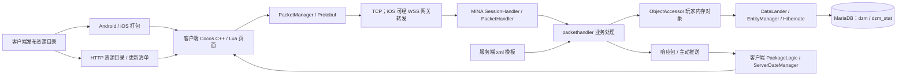

# 代码逻辑与扩展指南

本文档组以 2026-11-02、代码提交 `5378e1af` 为分析基线。路径均相对于仓库根目录，不依赖克隆位置。通过读取源码、XML、资源表及发布资源核对结论；本次未编译、启动服务、修改玩家数据或新增游戏内容。

## 按问题查阅

| 问题 | 文档 |
|---|---|
| 服务端数据保存、修改、更新、发钻石和道具 | [01 服务端数据与奖励](01_服务端数据保存与奖励发放.md) |
| 客户端资源位置、替换图片与发布 | [02 客户端资源](02_客户端资源与图片替换.md) |
| 卡牌数量、新增卡牌、缘分控制 | [03 卡牌与缘分](03_卡牌与缘分.md) |
| 装备数量、穿戴强化、新增装备 | [04 装备](04_装备与强化.md) |
| 奥义数量、学习升级、新增奥义 | [05 奥义](05_奥义与技能.md) |
| 船舱是否存在、现有相近功能、扩展边界 | [06 船舱与修行](06_船舱与全队修行.md) |
| 新版 APK 的卡牌、装备、奥义和玩法移植候选 | [07 新版 APK 移植清单](07_新版安装包移植清单.md) |
| 首批44张卡牌、29件装备、9个被动奥义的移植和更新 | [08 首批内容移植](08_首批内容移植与更新.md) |
| 注册、认证、自动登录、切换账号与三端存档绑定 | [09 游戏账号体系](09_游戏账号体系.md) |

## 总体执行链路

客户端负责交互、显示、战斗表现及部分本地计算；服务端负责玩家资产、合法性校验、战斗业务结果和保存。改客户端表中的数值，不等于改了玩家的服务端属性。

| 层次 | 主要位置 | 用途 |
|---|---|---|
| 服务端入口 | [DZM.java](../../server/source/src/com/oldmountain/dzm/DZM.java) | 启动配置、网络、定时任务 |
| 网络分发 | [PacketHandler.java](../../server/source/src/com/oldmountain/dzm/net/packet/PacketHandler.java) | 按操作码分发请求 |
| 服务端业务 | `server/source/src/com/oldmountain/dzm/{packethandler,services,util,entity,persist}` | 业务、实体、缓存与持久化 |
| 客户端逻辑 | `client/source/Game/{Classes,Protobuf,Platform}` | C++ 页面、协议及平台接口 |
| Android 接入 | `client/source/Game/proj.android/src` | Activity、存储、登录与资源准备 |
| iOS 接入 | `client/ios` | 新 iOS 工程、资源准备及构建 |
| 资源发布源 | `resources/client` | 两端打包与 HTTP 资源生成的实际输入 |
| 明文资源资料 | `archive/client-resources` | 文本表、图片、Lua 等编辑参考 |
| 自动部署 | [deployment/server.py](../../deployment/server.py) | 安装运行目录、数据库、启动停止和备份 |

## 原分析基线的内容规模

以下表格及原始 CSV 保留分析时的快照。本批移植后为卡牌2368、装备120、奥义86、缘分940，新增清单和更新步骤见 [08 首批内容移植](08_首批内容移植与更新.md)；本批已完成 Android 构建和雷电实测，见 [验证记录](../reference/首批移植内容安卓实测记录.md)。

| 内容 | 服务端模板数 | 发布资源模板数 | 补充口径 |
|---|---:|---:|---|
| 卡牌 | 2324 | 2324 | 199 条“是否显示=1”；379 个不同名称，不代表379名独立可招募角色 |
| 装备 | 91 | 91 | 武器37、防具28、饰品26 |
| 奥义 | 77 | 77 | 55单体、13群体、9被动；碎片配置另有322条、关联73种奥义 |
| 缘分 | 688 | 688 | 人物592、奥义18、装备78 |

卡牌、装备、奥义两端的 ID 集合相同；发布目录对应表解码后与明文资料文件逐字节一致。数量是模板数量，不是某个账号拥有的实例数，也不是全部都能从当前卡池获得。

完整清单：[卡牌](data/cards.csv)、[装备](data/equipment.csv)、[奥义](data/skills.csv)。CSV 使用 UTF-8 BOM，便于 Windows Excel 打开。CSV 是此次分析快照，不参与游戏加载；以后改配置时应同步更新清单和统计。

## 修改后更新哪一层

| 改动 | 服务端处理 | 客户端处理 |
|---|---|---|
| 给某个角色补钻石/道具 | 走奖励逻辑，或停服后改玩家数据库 | 接收响应/领取奖励/重新登录 |
| 调整模板数值 | 修改源码 XML，更新运行目录并重新加载 | 对应显示表也需同步；已有实例可能另需迁移 |
| 替换同名图片 | 通常不改游戏 Java | 同步发布资源、版本和安装包/更新清单 |
| 新增卡牌/装备/奥义 | 新增模板、获取途径，必要时修改算法 | 新增相同ID、文字和资源，重新发布 |
| 新玩法/协议/数据库字段 | 修改 Java、映射/SQL、Protobuf 后重新构建 | 修改 C++/Lua/协议并重新打包 |

源码目录、部署运行目录、客户端安装后的缓存是三个不同位置。只改其中一处经常会出现“源文件改了，游戏没变化”；具体操作见各专题。

## 后续维护方式

每次扩展记录：模板ID、两端修改文件、资源文件、获取途径、旧账号迁移需求、资源版本和验证结果。新增专题可继续使用 `07_*.md`，在本页增加入口；把“源码已具备”“静态发现的问题”和“实际运行验证通过”分别写清楚。
